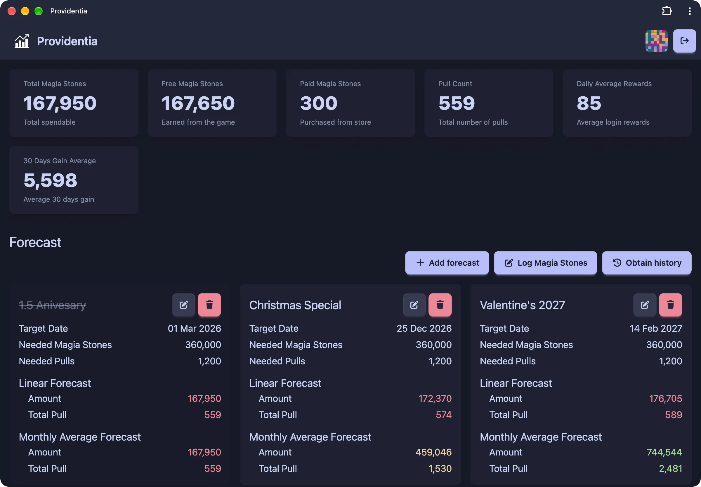

# Providentia

Gacha game "currency" tracker and planner. Log the gems you earn and spend, see your totals, and forecast whether you can afford a target pull or copy by a given date.



## Features

- **Gem log:** record gem gains and spends as free or paid, with an optional note. Totals are kept per type and overall.
- **Overview:** current free, paid and total gems, plus your average daily gain over the last 30 days.
- **Obtain history:** table and list views of past gem changes.
- **Forecasts:** named target dates with projected gem totals. Each forecast shows whether you reach a target (`hit`) or a safe buffered amount (`safe`), using both a fixed daily average and your own 30-day average.
- **Note presets:** save short notes to reuse when logging gems.
- **Profile:** change username and password, rescan stats, and manage note presets.
- **Account:** first run shows a setup page to register a single account. Login uses JWT access and refresh tokens, with logout from the current session or all sessions.
- **Installable PWA:** works as a home screen app on mobile, with a responsive layout. See [Why a PWA](#why-a-pwa).

## Why a PWA

Providentia is a Progressive Web App by design, not a native iOS or Android app. The reasons:

- **Experiment:** to see what PWAs can do today on mobile.
- **Avoid app stores:** the Apple Developer Program is not worth the cost for what this project does, so a PWA is the alternative to a native iOS app.

## Roadmap

- **Multi-account:** planned, but no ETA yet, since there is no proven use case.

## Tech stack

- [SvelteKit](https://kit.svelte.dev/) with Svelte 5, built with Vite
- [Tailwind CSS](https://tailwindcss.com/) and [DaisyUI](https://daisyui.com/), with Catppuccin themes
- [SQLite](https://www.sqlite.org/) via [libSQL](https://github.com/tursodatabase/libsql-client-ts) and [Drizzle ORM](https://orm.drizzle.team/)
- [TanStack Query](https://tanstack.com/query) and [TanStack Form](https://tanstack.com/form)
- [Zod](https://zod.dev/) for validation, [jose](https://github.com/panva/jose) for JWT, [Argon2](https://github.com/ranisalt/node-argon2) for password hashing
- [pnpm](https://pnpm.io/) as package manager

## Getting started

### Prerequisites

- Node.js (see `dockerfile` for the version used in builds)
- pnpm

### Configuration

Copy `.env.example` to `.env` and fill in the values. See [`env.md`](./env.md) for what each variable does.

```sh
cp .env.example .env
pnpm generate:jwt   # generates a JWT secret
```

### Development

```sh
pnpm install
pnpm db:migrate     # apply database migrations
pnpm dev
```

The app runs at `http://localhost:5173` by default.

### Production build

```sh
pnpm build
pnpm start          # runs ./build with .env loaded
```

### Docker

```sh
docker compose up --build
```

The app listens on port `3000` and stores its SQLite database in `./docker-data`.

[`docker-compose.yaml`](./docker-compose.yaml) builds the image from source by default. A prebuilt image is published to GitHub Container Registry on version tags (`v*`); its image line is commented out in that file, so uncomment it to use the prebuilt image instead.

## Scripts

| Script              | Description                                      |
| ------------------- | ------------------------------------------------ |
| `pnpm dev`          | Start the development server                     |
| `pnpm build`        | Build for production                             |
| `pnpm start`        | Run the production build                         |
| `pnpm check`        | Run `svelte-check` type checks                   |
| `pnpm lint`         | Check formatting with Prettier                   |
| `pnpm format`       | Format the codebase with Prettier                |
| `pnpm eslint`       | Run ESLint                                       |
| `pnpm db:generate`  | Generate a migration from schema changes         |
| `pnpm db:migrate`   | Apply migrations                                 |
| `pnpm db:push`      | Push the schema directly to the database         |
| `pnpm db:studio`    | Open Drizzle Studio                              |
| `pnpm db:tui`       | Open the database in lazysql                     |
| `pnpm generate:jwt` | Generate a JWT secret                            |
| `pnpm cloudflared`  | Expose the local app through a Cloudflare tunnel |

## Project structure

```
src/
  routes/          SvelteKit pages (_ is the logged-in area) and API routes under api/
  lib/
    client/        Browser components, TanStack Query services and utilities
    server/        Database schemas, services and server utilities
    schema/        Zod schemas for API payloads and forms
    constants/     Shared constants (gem types, stat keys)
    exception/     HTTP exception classes
drizzle/           SQL migrations
static/            Icons and PWA manifest
```

## License

Providentia is open source under the [Mozilla Public License 2.0](./LICENSE.md).
